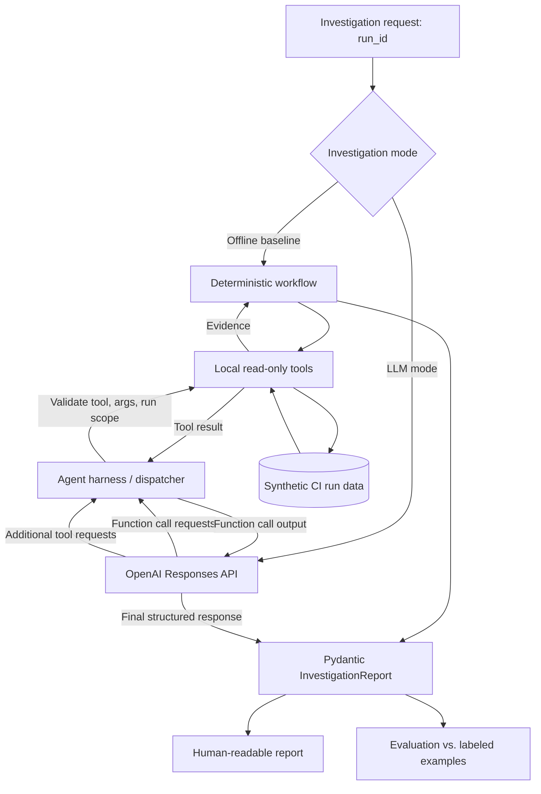
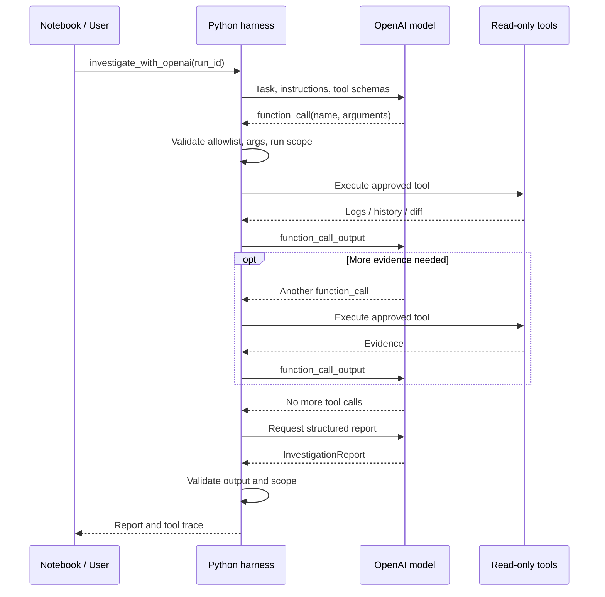

# CI Failure Investigator

**A local, evidence-driven CI/CD failure investigation agent built with Python and the OpenAI API.**

This Jupyter notebook demonstrates how an AI agent can investigate failed CI pipeline runs by choosing read-only tools, collecting relevant evidence, and producing a structured diagnosis. All pipeline data is simulated, so **GitHub, Jenkins, and a real CI server are not required**.

The project includes two investigation modes:

- **Deterministic baseline:** Python applies transparent classification rules after retrieving the same evidence. It runs offline, without an API key.
- **LLM-powered investigator:** An OpenAI model decides which tools to call, interprets their results, and generates a Pydantic-validated report. This requires an OpenAI API key.

> **Scope:** This is an educational/interview prototype, not a production-ready incident response system. The agent is read-only and makes recommendations; it does not modify code, rerun jobs, or deploy software.

## Architecture



### Main components

| Component | Notebook implementation | Responsibility |
|---|---|---|
| Pipeline data | `RUNS` | In-memory synthetic metadata, job logs, test outcomes, commit diff summaries, and hidden ground-truth labels |
| Tool layer | `get_failed_jobs`, `get_job_logs`, `get_test_history`, `get_commit_diff` | Read evidence using explicit interfaces that can later be replaced with CI provider integrations |
| Tool registry | `TOOLS` | Allowlist of executable functions |
| Tool schemas | `FUNCTION_SPECS` | Describe function names and argument types to the model |
| Tool dispatcher | `dispatch_tool` | Enforce allowed tool names, argument shape/types, and the active `run_id` scope |
| Agent instructions | `AGENT_INSTRUCTIONS` | Require evidence-based reasoning, uncertainty, read-only behavior, and human review |
| Agent harness | `investigate_with_openai` | Run the LLM/tool loop, return function results, bound iterations, record a trace, and validate the final report |
| Offline comparison | `investigate_offline` | Classify failures using fixed Python rules rather than LLM reasoning |
| Output contract | `InvestigationReport` | Validate categories, required evidence, confidence range, and other report fields using Pydantic |
| Evaluation | `evaluate_offline` and optional LLM evaluation cell | Compare predictions to synthetic labels and record execution statistics |

## How the agent works

The **LLM mode is an actual tool-using agent**, rather than a single prompt that asks a model to classify a log.

1. **Receive a target run.** `investigate_with_openai("run_001")` starts an investigation scoped to that run.
2. **Select tools.** The model sees tool definitions and decides which evidence it needs. It might start with `get_failed_jobs` and `get_job_logs`, then request `get_test_history` or `get_commit_diff` to refine its hypothesis.
3. **Validate and execute calls.** The Python dispatcher verifies the requested tool is permitted, arguments are valid, and the model cannot access a different run. It executes the corresponding local function.
4. **Feed tool results back to the model.** The harness appends function-call outputs to the conversation. The model can use the new evidence to choose another tool.
5. **Stop on completion or budget.** The loop is bounded by `max_rounds` (default: 6). If the model exceeds the limit, the investigation raises an error instead of continuing indefinitely.
6. **Generate a typed report.** A separate structured-output request uses `client.responses.parse(..., text_format=InvestigationReport)` to produce a report. Pydantic checks the report shape; the harness checks its `run_id` and enforces `needs_human_review=True`.
7. **Render and optionally evaluate.** The notebook displays an explanation with evidence and recommended next steps. Optional evaluation compares classifications against hidden expected labels.



**Agent vs. harness:** The **model** reasons about the task and selects tools. The **harness** is regular Python code that controls execution, validates requests, retains context, records activity, and enforces limits. The local functions implement the tools. The model does not execute arbitrary Python.

### Tool interfaces

All four tools operate on the **synthetic `RUNS` dictionary** and are read-only.

| Tool | Arguments | Returns | Why the agent uses it |
|---|---|---|---|
| `get_failed_jobs` | `run_id` | Run metadata, pipeline name, commit, failed job names | Identify which jobs failed |
| `get_job_logs` | `run_id`, `job_name` | Job log excerpt (up to 4,000 characters) | Observe actual error messages and exit status |
| `get_test_history` | `run_id` | Recent test pass/fail outcomes | Look for intermittent failures |
| `get_commit_diff` | `run_id` | Short commit diff summary | Assess whether a recent code change plausibly explains a failure |

A production version could keep the same interface while replacing dictionary lookups with API calls to GitHub Actions or Jenkins, test-result storage, and source control.

## Investigation output

The Pydantic `InvestigationReport` schema contains:

```json
{
  "run_id": "run_001",
  "failure_type": "regression",
  "suspected_root_cause": "Possible authentication behavior regression",
  "evidence": ["A test assertion failed", "A relevant code change was identified"],
  "recommended_action": "Reproduce the test and inspect the auth change",
  "confidence": 0.75,
  "needs_human_review": true
}
```

*Illustrative report, not a quoted model response.* The permitted categories are `regression`, `infrastructure`, `flaky`, and `unknown`. The `confidence` field is an **uncalibrated estimate**, not a validated probability that the diagnosis is correct. The system may choose `unknown` when evidence is insufficient.

### Simulated cases

| Run | Pipeline | Expected label | Key evidence |
|---|---|---|---|
| `run_001` | `robot-cloud-api` | `regression` | Failed authentication assertion plus a relevant code change |
| `run_002` | `robot-cloud-api` | `infrastructure` | Package registry returned HTTP 503 / connection timeout |
| `run_003` | `fleet-telemetry` | `flaky` | Timeout with alternating historical pass/fail results |
| `run_004` | `nightly-validation` | `unknown` | Truncated log and insufficient evidence |

These labels are ground truth for **evaluation only**; the read-only tools do not expose the `truth` field to the agent.

## Getting started

### Requirements

- Python **3.10+** and Jupyter Notebook, JupyterLab, or VS Code with a notebook kernel
- `pydantic>=2.0`
- `openai>=2.0` for LLM mode
- `python-dotenv` **optional**, if you want the notebook to load a local `.env` file
- An OpenAI API key **only for LLM mode** (API usage is billed separately)

Install packages in a notebook cell:

```python
%pip install -q "openai>=2.0" "pydantic>=2.0" python-dotenv
```

### Environment configuration

Create a local `.env` file alongside the notebook:

```dotenv
OPENAI_API_KEY=replace_with_your_new_key
OPENAI_MODEL=gpt-6-luna
```

**If you are using `.env`, add this near the top of the notebook before the existing environment check or any OpenAI API calls:**

```python
from dotenv import load_dotenv
load_dotenv()
```

The distributed notebook reads `OPENAI_API_KEY` and `OPENAI_MODEL` from the process environment, but does **not** load `.env` automatically unless you add the lines above. Alternatively, export those environment variables in the shell before launching Jupyter.

Do not commit or share `.env` or keys. Add a `.gitignore`:

```gitignore
.env
.env.*
!.env.example
.ipynb_checkpoints/
__pycache__/
```

Because `.ipynb` files save cell outputs, **clear outputs before sharing** if any sensitive information or incident logs could be present. Use a fresh key if an earlier key was disclosed.

### Run the notebook

1. Open `CI_Failure_Investigator_Checked.ipynb`.
2. Run the setup, synthetic data, tools, schema, and offline baseline cells in order.
3. Inspect the four offline example reports and baseline evaluation.
4. Set `OPENAI_API_KEY` and run the OpenAI agent definition and execution cells. The provided live demo investigates **`run_001`** by default.
5. To investigate another case, run `investigate_with_openai("run_002")`, `investigate_with_openai("run_003")`, or `investigate_with_openai("run_004")` after the definitions have executed.
6. To evaluate all four using the paid API, change `RUN_LLM_EVAL = False` to `True` in the optional evaluation cell. This will make multiple API calls.

The live model is selected using:

```python
MODEL_NAME = os.getenv("OPENAI_MODEL", "gpt-6-luna")
```

You can change `OPENAI_MODEL` to a model available to your API account. **Model availability and pricing may change**, so confirm them before running a larger evaluation.

## Evaluation strategy

`evaluate_offline()` computes per-case results for the deterministic baseline: expected label, predicted label, correctness, number of tool calls, and elapsed time. The optional LLM evaluation runs the model on all four synthetic cases and compares its classifications with labels.

This is a **smoke test**, not evidence of real-world accuracy. The four examples are small, constructed, and relatively easy; passing them does not establish performance on realistic CI logs.

For a meaningful evaluation, collect a larger **held-out set of historical failures** labeled by engineers and measure:

- **Classification accuracy** and per-class precision/recall
- **False reassurance rate:** real regressions incorrectly dismissed as harmless (especially important)
- **Unknown / abstention rate:** how often evidence is insufficient
- **Root-cause usefulness:** whether an engineer can act on the diagnosis
- **Tool behavior:** relevant calls, unnecessary calls, malformed arguments, budget overruns
- **Latency and cost per investigation**
- **Stability:** consistent conclusions on repeated or noisy runs

Start with human-reviewed, read-only reports in **shadow mode** before considering automated actions.

## Safety, boundaries, and tradeoffs

- **Read-only tool allowlist:** only the four declared tools can execute. There are no deployment, retry, or code-edit tools.
- **Run isolation:** a tool call for a different `run_id` is rejected.
- **Input validation:** dispatcher checks exact argument names and string types.
- **Bounded evidence:** logs are truncated to 4,000 characters, limiting context and cost (but potentially omitting useful evidence).
- **Tool-call budget:** the agent stops on excessive investigation rounds rather than looping forever.
- **Prompt-injection awareness:** logs are treated as untrusted *data*, not instructions to obey. The current implementation has only basic defenses and is not hardened for adversarial logs.
- **Structured reports:** Pydantic checks the output schema; it **cannot prove factual correctness**. Evidence must still be checked against tool responses.
- **Human review:** recommendations do not authorize operational changes.

### Why not simply ask an LLM to read a log?

A single LLM call sees only what is put into its prompt. A tool-using agent can gather additional evidence as needed, such as prior test history and relevant code changes. The harness gives that process clear boundaries and an auditable tool trace. However, for straightforward, known error signatures, deterministic parsing can be cheaper and more dependable. This notebook deliberately implements **both** approaches so their tradeoffs are visible.

## Limitations and next steps

**Current limitations:** All data is synthetic and stored in the notebook; it does not connect to a real CI provider. There is no persistence, authentication against real systems, calibrated confidence, real-world evaluation dataset, or automatic root-cause verification. The LLM loop uses a fixed maximum number of rounds and a separate final structured-output call.

**Possible next iterations:**

1. Replace the synthetic tool implementations with **GitHub Actions/Jenkins adapters**, keeping the same tool contracts.
2. Add incremental log retrieval, search, and artifact access to handle large real-world runs.
3. Store historical diagnoses and engineer feedback for evaluation and regression testing.
4. Add tests for malformed tool calls, timeouts, prompt injection, missing logs, and ambiguous failures.
5. Add tracing/metrics for token usage, response latency, cost, and tool success rates.
6. Integrate with PR comments or a dashboard in **recommendation-only mode**, with explicit human approval for any future side-effecting actions.

## Project structure

The prototype is intentionally packaged in one shareable notebook:

```text
CI-Failure-Investigator/
├── CI_Failure_Investigator_Checked.ipynb   # Data, tools, agents, evaluation, explanations
├── README.md                              # This file
├── .env                                   # Local secrets (never share)
└── .gitignore                             # Excludes secrets and notebook checkpoints
```

## Summary

> I built a Python CI/CD failure investigator to explore how agentic workflows can accelerate developer debugging. It uses synthetic CI logs, read-only tools, a bounded OpenAI tool-calling loop, and structured Pydantic reports. I also implemented an offline rule-based baseline and a small evaluation harness. The key design choices are separating the agent from the tool-execution harness, keeping tool permissions narrow, requiring evidence-backed conclusions, and making uncertain cases explicit. The next step would be replacing the local data adapters with real CI APIs and evaluating on historical failures before deploying it for engineers.

---

**Technology:** Python · Jupyter · OpenAI Responses API · Function calling · Pydantic · Synthetic CI/CD data
